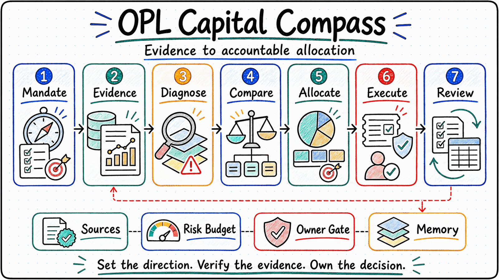

# OPL Capital Compass 智能体白皮书

> 让每一次资本配置，都有看得懂的依据和可持续复核的方向

<!-- Owner: `OPL Capital Compass`; Purpose: `public_occ_whitepaper_body_source`; State: `active_public_source`; Machine boundary: Public whitepaper prose published through the OPL family bundle. Private implementation code, account data, model evaluations, and qualification records stay in the private OPL Capital Compass repository. -->

发布日期：2026-11-05

最近修订：2026-11-24

适用对象：希望理解金融产品、组织个人资产配置、持续复盘投资判断的个人投资者，以及关注决策智能体设计的研究者、开发者与合作者。

核心判断：个人投资需要把目标、产品机制、市场证据、组合风险和行动结果组织成一条连续的决策线。AI 的价值在于提高这条决策线的清晰度、可检验性与连续性。

本文解释 OPL Capital Compass 为什么这样设计、可以提供什么判断能力，以及用户如何与它共同维护一套长期可用的投资方法。

## 定位摘要

OPL Capital Compass（OCC）是 One Person Lab 系列中的个人资本配置决策智能体。它从投资者的目标、期限、流动性需求与风险承受能力出发，把金融产品研究、组合诊断、中美宏观分析、方案比较和后续复盘连接起来。

用户可以从一个产品疑问、一次市场变化、一份账户记录或一个配置目标开始。OCC 组织证据、解释机制、比较选择，并留下下一次能够继续使用的判断依据。用户负责接受或修改方案，以及真实资金行动。

这套设计希望带来三个可感知的结果：

- **看懂收益从哪里来。** 分红、净值、利息、费用和汇率各自如何影响结果，产品在什么条件下会亏损。
- **看清组合在承担什么。** 多个标的是否依赖同一类需求、融资条件或利率环境，风险是否符合资金用途。
- **知道何时重新判断。** 每个方案都有比较依据、失效条件和复核时点，新的信息能够接回原来的决策。

## 个人投资需要一条连续的决策线

投资中的许多困难发生在环节之间。产品名称看似熟悉，真实的收益结构却没有拆清；市场判断有说服力，买入价格和仓位却缺少约束；一次配置经过认真讨论，几周后又找不到当时的理由；账户里的现金、分红与交易结果分散在不同页面，难以算清总账。

这些断点会互相放大。把高分红理解成保本，会低估价格波动；把多个行业代码理解成充分分散，会忽略共同的融资风险；把长期产业趋势直接转换成买入指令，会跳过估值、期限和现金需求。

OCC 围绕同一个决策维护连续上下文：最初要解决什么问题，依据哪些事实，比较过哪些方案，最终接受了什么，以及后来发生了什么变化。用户回来时，能够接着已有成果继续判断。

这条决策线允许回退。新证据可能改变产品理解，现金需求可能改变配置比例，执行回读可能改变下一步计划。每一次修订都应说明改变的依据。



## OCC 的设计思想

**先确定钱的用途。** 资金多久会用到、需要多快取出、能承受多大损失，决定了可以考虑哪些资产。日常支出准备金是独立约束，配置比例必须说明分母是总资产、扣除准备金后的可投资资产，还是某个账户。

已知支出与未来负债按到期时间分桶，风险承受能力与主观风险意愿分别判断。养老、年金、保险和法定待遇需要区分承诺收入与可投资资产；如果可接受风险下的预期回报无法覆盖目标，调整支出、投入、时点或保障方式，比假设更高收益更可靠。

**用机制解释产品。** 研究从实际资产、合同现金流和损益路径开始。产品的标签、历史涨幅与宣传收益率，只能提供线索。

**用证据约束判断。** 关键事实记录来源、观察期、发布日期和统计口径。计算、解释、预测与假设分别表达；证据冲突时，保留冲突并指出需要补什么。

**用选择承载结论。** 配置建议需要说明相对于维持现状改善了什么，又增加了哪些成本与风险。证据不足时，缩小行动、分批实施或维持现状都是有效选择。

**用复盘积累能力。** 每次讨论都应留下能够复用的机制认识，以及带日期的状态记录。下一次复核从这些材料继续，减少重复分析和事后改写理由。

## 从产品机制到组合风险

### 收益需要算总账

现金分配是投资结果的一部分。假设以 100 买入一份资产，期间收到 4 的现金分配，期末价格为 90；在没有其他资金流、再投资、税费与汇率影响的情况下，总回报是 −6%。收到现金与本金价值下跌可以同时发生。

账户总账还需要区分资金进出和投资损益。统一估值口径后，期间经济损益可以从“期末净清算价值＋期间外部转出－期间外部转入－期初账户价值”核对。已留在账户现金中或已再投资的分红，不再重复加一次。逐项归因再拆成已实现损益、未实现损益、分红、利息、费用和税款。

转入资产需要明确计量边界。转入日市值可以作为账户观察期的起点；原始买入成本用于更早的持有收益或税务成本判断，两者回答不同的问题。缺失成本保留为未知。跨币种分析说明汇率日期与换算方法；时间加权收益率用于观察资金进出影响之外的投资表现，资金加权收益率反映实际投入时点对投资者结果的影响。

### 相似名称可能对应不同风险

| 产品或结构 | 收益与风险需要怎样理解 |
| --- | --- |
| 红利股票基金 | 股息来自企业分配，股价取决于盈利、估值与风险偏好；股息率不能直接替代保本产品收益率 |
| 债券基金 | 收益由票息、价格变化及费用共同构成；基金持续持有和调整组合，投资者没有与单只到期债券相同的到期兑付路径 |
| 国债与买入看涨期权的组合 | 国债承担久期风险，期权提供约定的上涨敞口并可能损失权利金；买入看涨期权与卖出备兑看涨期权的损益结构不同 |
| 波动率期货产品 | 暴露由期货合约、期限结构、展期和跟踪方式决定，现货波动率横盘也可能出现持有损失 |
| REITs | 现金流受租金、出租率、运营成本和融资影响，市场价格还受到利率与估值变化影响 |
| 短期或现金管理产品 | 可用性取决于赎回、到账、持有期和额度条款；存在七天限制的资金不能直接覆盖当日支付需求 |
| 股票 | 收益来自盈利与现金流增长、分配、估值变化和汇率；盈利收益率不是无风险债券票息 |
| 银行与保险公司 | 银行看资产质量、存款与批发融资、资本和流动性；保险还要看准备金、承保和资本约束 |
| 黄金与商品 | 不产生合同利息或股息；真实利率、机会成本、储备需求、期货曲线与展期都可能影响结果 |

OCC 按具体产品核对底层资产、久期、杠杆、期权、展期、分配来源、费用、流动性、信用、税务与汇率。适用时还会追问：如果标的价格不变、市场波动恢复常态，长期持有靠什么赚钱，又会持续付出什么成本？

估值要使用匹配的分母和现金流口径。市盈率、EV/EBITDA 与价格/自由现金流会因杠杆、税、资本开支和会计处理给出不同排序；低倍数、过去高价或知名品牌都不能单独证明便宜。银行与保险公司需要按融资、信用、准备金和资本监管的结构分析。

### 分散要回到共同风险源

电网设备商、数据中心房东和算力硬件供应商，收入机制各不相同，却可能共同依赖大型客户的资本开支与融资条件。OCC 同时保留两层判断：每类资产的独特驱动，以及整个组合共享的风险。

共同风险需要总预算，单一公司还需要独立限额。历史相关性只描述样本中的价格关系；因果分析还要看客户、合同、债务、订单和现金流。一次同跌不能证明资产完全同质，一次分化也不能证明共同风险已经消失。

风险标签可以重叠，同一资产可能同时暴露于利率、汇率与产业周期，因此不能把这些标签比例当作互斥资产权重相加。基础情景、压力情景和判断失效情景共同帮助用户理解集中度。

风险指标必须记录定义、期间、频率、币种、费用和基准。波动率、历史最大回撤、VaR、条件 VaR 与 Sharpe 比率回答不同问题：历史回撤不是未来损失上限，VaR 不描述阈值外的尾部损失。期权、杠杆、估值平滑和赎回约束还需要压力测试。

信用与流动性风险可通过共同借款人、抵押品、保证金、再融资和被迫出售传染。短期资金以较长期或难变现资产支撑时，正常时期看似稳定，压力下可能出现赎回限制和折价。基准国债收益率下降也不等于所有借款人的融资成本下降。

## 宏观判断怎样进入配置

### 中美市场使用同一套纪律，保留不同传导机制

OCC 每次重新识别市场所处的阶段：需求变化、供给冲击、通胀或通缩压力，如何经过政策、利率、信用和企业盈利传到资产价格。国家标签和过去的判断需要由新的数据重新验证。

美国市场分析关注政策利率之外的实际利率、通胀预期、期限溢价、财政融资、信用利差与盈利。中国市场分析结合居民收入预期、消费、房地产、民间投资、信用、出口和政策落地。工业生产较强与内需偏弱可以并存，政策宣布与需求恢复也需要分别观察。

跨市场比较先统一口径。美国 GDP 环比折年率与中国 GDP 同比不能直接作为同一维度比较；CPI、PPI、名义增长、实际增长和资产价格分别描述不同现象。数据的观察期、发布日期和后续修订都影响结论。

### AI 产业需求与融资能力分别检查

AI 基础设施增长同时包含经营链和融资链：

```text
需求与利用率 → 订单、资本开支与租赁承诺 → 收入兑现与自由现金流
                                         ↓
项目进度与资产估值 ← 融资成本与可得性 ← 债务发行、信用利差与偿付能力
```

资本开支上升可能带来设备和机房需求，也可能伴随自由现金流下降、债务增加及再融资压力。OCC 检查投入是否转化为收入和现金，风险由哪一层承担，以及当前价格已经计入多少增长。

基准国债收益率下降，也可能发生在避险资金流入的时期。如果信用利差同时扩大，企业实际融资成本仍可能上升。对股票、REITs 和债券的影响需要沿各自现金流与融资结构判断。

因此，行业方向、资产估值、融资健康和组合适配是四个关联的判断。它们共同决定行动规模与复核条件。

## 六个阶段如何协同

OCC 使用六个阶段承载不同判断。用户只需提出问题，系统根据缺口选择需要的阶段。

| 阶段 | 核心问题 | 用户得到的成果 |
| --- | --- | --- |
| 任务与现状 | 这次决定什么，资金用途和约束是什么，已有信息能支持到哪里？ | 清楚的问题、范围、信息日期与缺口 |
| 产品与证据 | 产品怎样赚钱和亏损，关键说法依据什么？ | 产品机制解释、证据与待核实事项 |
| 组合与宏观 | 资产共享哪些风险，宏观变化如何传导？ | 风险分布、传导链与压力情景 |
| 决策设计 | 持有、增减、再平衡或维持现状，如何取舍？ | 方案比较、建议、失效条件与复核计划 |
| 执行准备 | 当前账户能否支持具体计划，怎样确认和核对结果？ | 可审阅的交易准备与回读要求 |
| 记录与记忆 | 这次决定为什么成立，哪些内容需要长期保留？ | 决策记录、长期知识与当前状态更新提案 |

纯产品研究可以沿“任务与现状—产品与证据—记录与记忆”完成，无需提供账户。涉及仓位与交易准备时，再加入组合、决策和执行阶段。发现上游判断有误时，后续阶段可以带着问题返回修订。

总览图中的比较与配置由同一个决策设计阶段承载。七个用户工作环节与六个实现阶段分别描述用户旅程和内部判断分工。

## 用户如何开始

用户可以直接提出一个需要弄清的问题：

- “这个基金一直分红，帮我算清楚分红与总回报，并解释可能亏损的原因。”
- “电网设备和数据中心基金是否依赖同一类风险？比较维持、减仓和再平衡。”
- “我需要保留日常支出资金，帮我比较人民币与美元资产的配置方式，列出下一次复核条件。”

OCC 先确定当前问题是否需要账户数据。研究产品和宏观可以从公开资料开始；计算账户表现需要相应资金流与成本记录；准备具体交易需要新鲜的持仓、现金、未结订单与市场状态。

一个可使用的决策成果应让读者独立理解：结论是什么，依据是什么，比较过哪些选择，有哪些未知，什么变化会推翻结论，以及下一步怎么做。

OPL 的共享工作入口把这些成果连接到当前项目。用户与 Agent 读取同一份决策包和执行计划，保留备选方案、证据、质量待办与真实执行状态。项目目录中的明确引用帮助用户直接打开已有成果；出现多个项目或多个决策产物时，由用户选择要查看的对象。界面负责呈现和导航，投资判断、方案接受与交易授权仍沿用原有分工。

## 一个合成的微型案例

**问题。** 一位投资者看到两个基础设施基金同时下跌，想知道是否应该立即减仓。以下场景用于说明工作方法，未使用真实账户信息。

**任务。** OCC 先区分两种需求：解释这次波动，还是改变配置。若需要后者，再明确投资期限、流动性准备金和主题风险预算。只有旧持仓记录时，可以继续分析，但暂不计算今天可卖出的数量。

**机制。** 一个基金主要持有电网设备和工程企业，另一个主要持有数据中心及通信设施资产。前者更直接暴露于订单、交付、成本与工业投资；后者更直接暴露于租金、出租率、租约和融资。共同风险包括利率、客户投入与资金可得性。

**证据。** OCC 核对最新基金持仓、企业披露、收益率与信用数据，分别记录观察期。租约能够支持一定的收入可见性，同时仍要检查客户信用、合同条款、运营成本和再融资条件。

**选择。** 比较维持现状、降低整个主题比例，以及只调整其中一种资产。方案使用相同的资产范围和分母，列出费用、流动性影响与压力损失。若主题已超预算，降低敞口有明确理由；若预算内且证据没有改变原判断，则可以继续观察。

**复核。** 监测条件写成“什么指标、从哪里取数、何时检查、会改变哪个决定”。例如，持续的订单撤销、租金或出租率恶化、信用利差扩大，以及个人现金需求变化，分别触发不同层面的复核。价格下跌提供新的估值信息，还需要结合基本面判断。

**记录。** 本次结论、证据与缺口进入决策记录；“共同风险与收入机制需要分别分析”可以成为长期知识；具体价格、仓位与待办保留在带日期的当前状态中。

## 行动与维持现状都需要理由

每个重要方案比较收益来源、费用、流动性、税务影响和不利情景。预期收益由假设支持，不能把历史年化或当前股息率直接当作未来承诺。组合选择优先满足用户的约束，再比较复杂度和潜在收益。

分批建仓或退出可以降低单次择时的影响，但仍要说明总风险预算、每一步的条件和停止条件。它不能解决产品机制不清或资金用途不匹配的问题。

复核包含定期检查和事件触发两种方式。定期检查确认资金需求、风险比例与证据是否更新；事件触发关注政策、财报、合同、融资或账户发生的实质变化。每次复核可以得出继续持有的结论。

## 执行准备与人机协作

OCC 负责研究、诊断、方案比较、交易准备和获授权后的状态核对。用户保留方案接受、账户访问与真实资金提交的决定权。

具体交易计划需要核对账户、标的、方向、数量或金额、订单类型、价格纪律、有效时间、资金来源、费用，以及撤销或停止条件。可用现金与保证金购买力分别读取；持仓、现金、未结订单和市场状态不足以支持当前计划时，交易清单保持为空，先补齐这些事实。

真实订单由用户在行动时确认精确内容并提交。提交后以券商权威回读区分待成交、部分成交、成交、撤销和拒绝，再更新账户状态。一般性的配置意愿不替代这一步。OCC 当前不提交真实资金订单、不移动资金、不托管资产或启用保证金。

面向朋友或外部读者的研究使用独立分享稿，去除凭据、账户标识、私人持仓、交易规模和个人税务事实。税务、法律、保险与受托责任等专业问题，记录需要确认的事实和相应专业决策。

## 长期知识、当前状态与决策演进

| 记录层 | 保存什么 | 何时更新 |
| --- | --- | --- |
| 长期知识 | 产品机制、计算方法、共同风险识别和可复用判断原则 | 新证据支持修正或形成可泛化认识时 |
| 当前状态 | 带日期的持仓、现金、订单、市场数据、约束与待办 | 取得相应权威回读或新的有效资料时 |
| 决策演进 | 当时的证据、备选方案、接受的判断、执行结果与改变理由 | 每次实质决策或修订后 |

知识归属分为产品、用户或团队、主题与项目。通用金融机理由产品维护；个人协作偏好属于用户；长期投资方法属于用户的财务主题；一次具体规划的设计与经验属于项目。机制、政策、时点事实和决策记录是各范围都可能具备的内容性质，不能用目录位置代替有效性判断。

用户已有 Obsidian 等资料库时，相关正文继续在原处维护；没有独立资料库时，普通工作目录承担同样的职责。不同来源可以混合使用。每项知识保留稳定身份与唯一正文，个人投资方法无需随某个 OCC 项目重新建库。工作区保存任务产物、来源绑定、提案与回执；Framework 从已授权原文直接生成本次运行快照。

OCC 产生更新提案并负责投资语义审阅，Framework 提供来源解析、版本核验和可恢复写入。已批准的常规维护沿用有效授权。涉及投资原则、当前基线或证据冲突的实质改变，要说明依据与取代关系，并在写回前核对原文仍为被审阅版本。接受的修订返回同一正文，用户不需要手工维护副本或哈希。

每次任务固定实际使用的知识版本，生产、审阅和修复能够追溯同一份上下文。历史记录保留当时依据；来源撤权以及影响资金和行动的关键约束变化，需要在后续使用和行动前重新核验。派生摘要也随其来源版本和有效性更新。缺少最新账户事实可以保留一般机制分析，但不能继续给出依赖该事实的具体交易规模。具体归属划分与授权核验沿用 OPL 的统一知识工作流与来源绑定规则。

某个时点的价格、宏观状态或账户比例，只在相应时点与范围内有效。能够跨越具体账户和事件复用的机制认识，经过审查后进入长期知识。

## 可靠性如何被建立和检验

金融判断需要同时检查数字和解释。总回报算对，但关于期权、利率或分红的理由错误，仍然会误导下一次决策。审阅需要覆盖整段回答，包括模型主动补充的主张。

OCC 把确定性检查与专业审阅结合起来。合同和校验器检查格式、引用、日期、风险映射、准备金边界与订单状态证据；专业审阅判断产品机制、来源适用性、计算口径、宏观因果、隐私与建议是否成立。产品证据、决策设计和执行准备要求独立正式审阅，其余阶段使用生产者自查与修订。

独立审阅也会漏判，因此每份行为证据记录所用模型、提供方、推理设置、软件包内容、调用路线、输入与实际回答。某一组合通过几道题，仅支持该范围内的观察。运行成功、格式合格与金融判断可靠分别验收。

评测围绕真实容易出错的问题组织，包括分红与总回报、债券久期、期权结构、波动率期货展期、股票估值、银行与保险、目标与负债、信用和流动性传染、风险指标、黄金与商品、共同风险、宏观统计口径、陈旧账户信息、保证金与现金、订单状态、隐私和决策失效条件。覆盖合同把每项长期知识连接到实际阶段和对应案例，避免知识文件存在却未被调用。失败回答保留为改进依据，未经接受的结论不进入长期知识。

OCC 已经具备长期金融知识、行为评测定义、产物校验、个人知识接受写回与原生插件载体。两次托管研究试运行未通过金融语义验收；另一路径的四组早期合成题通过独立审阅。完整金融资格评估仍未完成。当前版本、知识覆盖、详细模型配置、运行证据与后续验收事项在 OPL Capital Compass 私有项目内持续维护并按实更新。

## 与 One Person Lab 的关系

OCC 把投资领域能力放在 One Person Lab 的通用运行基础上：

```text
用户：目标、约束、方案接受与真实资金决定
  ↕
OCC：产品解释、证据判断、组合诊断、方案与决策记录
  ↕
OPL Framework：阶段运行、接口生成、持久化、恢复与状态投影
```

OPL Meta Agent（OMA）支持智能体的目标理解、设计依据、蓝图与评测设计；Framework 负责相应工程生命周期。OCC 持有投资方法、领域产物和质量判断。共享运行能力可以演进，投资判断的责任始终有明确归属。

这种分工使 OCC 能够专注于个人资本配置，同时复用 OPL 已有的执行和恢复能力。用户主要面对投资问题、证据、方案与下一步。

## 延伸阅读

- [One Person Lab 白皮书](https://gaofeng21cn.github.io/one-person-lab/latest/whitepapers/opl-whitepaper.html)：OPL 家族总体愿景与专业工作方式。
- [OPL Framework 白皮书](https://gaofeng21cn.github.io/one-person-lab/latest/whitepapers/opl-framework-whitepaper.html)：共享运行底座、阶段编排、知识与状态边界。
- [One Person Lab App 白皮书](https://gaofeng21cn.github.io/one-person-lab/latest/whitepapers/opl-app-whitepaper.html)：本地优先的连续工作台与插件生态。
- [OPL Agent Apps 与 MiniApp 白皮书](https://gaofeng21cn.github.io/one-person-lab/latest/whitepapers/opl-miniapp-whitepaper.html)：Agent 原生应用协作与共享知识/连接规范。
- [Med Auto Science 白皮书](https://gaofeng21cn.github.io/one-person-lab/latest/whitepapers/mas-whitepaper.html)：医学科研领域的 OPL 领域智能体实践。

本白皮书维护公开的产品理念与设计原则；OPL Capital Compass 实现仓库当前以私有方式维护，具体市场判断、账户现状与行动决定保留在各自带日期的研究与决策记录中。
